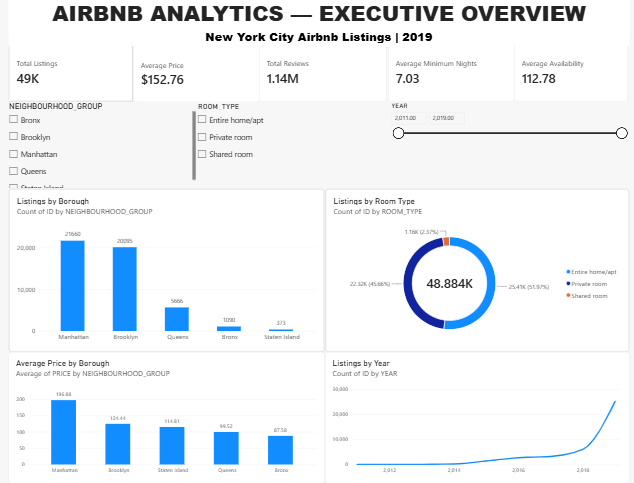

# Airbnb Analytics & Business Intelligence Project

An end-to-end data analytics and Business Intelligence project using the Airbnb NYC 2019 dataset. The project transforms raw listing data into a structured analytical solution using Python, Snowflake, SQL, and Power BI.

##
## 🎯Business Problem & Goals

The project explores Airbnb listing data to answer key business questions around:

Listing distribution across NYC boroughs and neighbourhoods

Pricing patterns by location and room type

Room type distribution and availability

Host activity and review performance

Trends in listing activity and availability

The objective was to build a structured data solution that could support business-oriented analysis and interactive reporting.


##
## 🛠 Technologies 


| Category               |  Technologies    |
| --------------------   |  ------------    | 
| Programming            |  Python          | 
| Data Manipulation      |  Pandas          |
| Data Warehouse         |  Snowflake       | 
| Query Language         |  SQL             |
| Business Intelligence  |  Power BI Online | 
| Version Control        |  Git & GitHub    |


##
## 🔑Key Skills 

◽Data profiling and cleaning

◽Data transformation using Python/Pandas

◽Dimensional modelling and Star Schema design

◽Cloud data warehousing with Snowflake

◽SQL-based business analysis

◽Power BI semantic modelling and dashboard development

◽Git/GitHub project documentation

##
## 📈 Dashboard Preview

#### Executive Overview – Overall marketplace KPIs and listing distribution


 
The Executive Overview provides a high-level summary of the Airbnb NYC marketplace through key performance indicators (KPIs) and visualizations. It highlights listing distribution across boroughs and room types, average prices by borough, and listing trends by year.

#### Explore Other Dashboard Pages

The report includes three additional pages for more detailed analysis:

<a href="screenshots/powerbi/pricing_analysis.PNG">Pricing Analysis</a>– Explores price differences across boroughs and room types, listing price ranges, and the relationship between price and minimum-night requirements.


<a href="screenshots/powerbi/location_room_analysis.PNG">Location & Room Analysis</a> – Examines listing concentration across neighbourhoods and boroughs, room type distribution, and average availability.

<a href="screenshots/powerbi/host_performance_analysis.PNG">Host & Performance Analysis </a> – Explores host listing activity, review performance, and availability patterns across room types.

<a href="powerbi/Power_bi_Report.md">View Power BI Report</a>/n
<a href="powerbi/Airbnb Analytics Dashboard.pbix">Power BI Dashboard</a>

##
## Project Documentation

📖 Detailed Project Walkthrough: <a href="https://medium.com/@jayawansa123s/building-an-end-to-end-airbnb-analytics-solution-with-python-snowflake-sql-and-power-bi-f2ad4544a234
">Read the Medium Article</a>


Repository Structure
```text
Airbnb-Analytics-Project/
│
├── data/                 # Raw and processed datasets
├── docs/                 # Project documentation
├── diagrams/             # Data model diagrams
├── sql/                  # SQL scripts and analysis
├── powerbi/              # Power BI resources
├── screenshots/          # Dashboard screenshots
└── README.md             # Project overview
```


##
## 🗃️ Dataset

Source: Kaggle – Airbnb NYC 2019

Original size: 48,895 rows × 16 columns

Final analytical dataset: 48,884 listings

The dataset contains listing, host, location, room type, pricing, review, availability, and date-related information.

